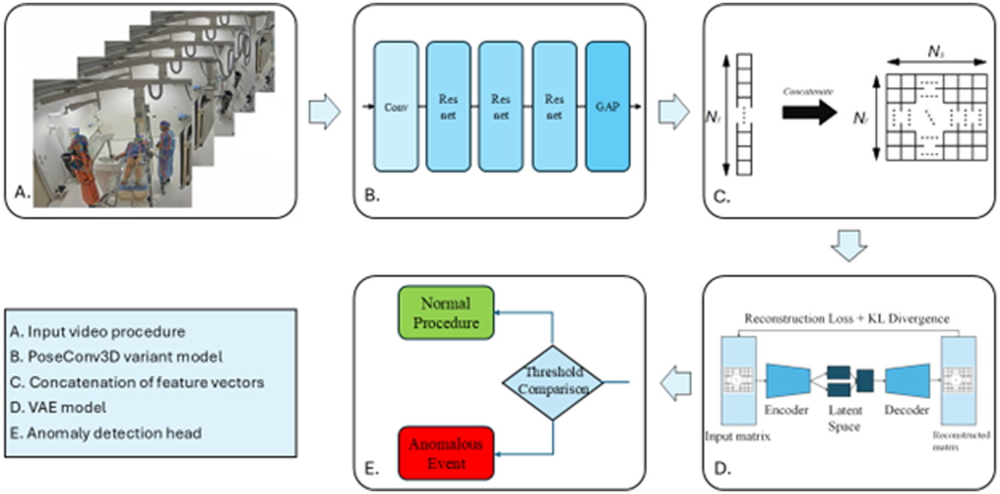

# Unsupervised anomaly detection in coronary angiography

**Research code accompanying a peer-reviewed study of video- and pose-based anomaly detection in coronary angiography.**

[Read the published paper](https://doi.org/10.1080/13645706.2026.2705585) · [Citation](#citation) · [Reproducibility notes](docs/reproducibility.md)

> **Research software, not a clinical device.** This repository is a collection of experimental scripts associated with the paper. It does **not** contain the hospital recordings, pose annotations, pretrained feature-extraction checkpoints, trained VAE checkpoints, or a fully validated end-to-end reproduction package. Reported paper metrics below are **from the publication**, not from newly executed tests of this repository.

## Reproducible multimodal VAE (PyTorch)

A standalone [modern implementation](modern_vae/) provides an independently testable multimodal variational autoencoder for procedure-level anomaly detection.

The implementation includes:

- Separate LSTM encoders for RGB and pose features.
- Intermediate fusion through a shared Gaussian latent representation.
- Modality-specific LSTM decoders.
- Padding-aware reconstruction loss.
- Normalization fitted exclusively on normal training procedures.
- Independent training, validation, calibration and test sets.
- Deterministic reconstruction-based anomaly scoring.
- Synthetic multimodal experiments and automated tests.

### Quick start

```bash
python -m pip install -r modern_vae/requirements.txt
python -m pytest modern_vae/tests -v
python -m modern_vae --normal 64 --anomalies 32 --epochs 12 --seed 42 --output /tmp/vae_synthetic.json
```

See the [implementation documentation](modern_vae/README.md) for the mathematical formulation, experiment configuration and reproducibility instructions.

The synthetic benchmark verifies the software pipeline without requiring hospital recordings or pretrained feature extractors. Its results are not clinical performance estimates or a reproduction of the published study.

## Research overview

Coronary angiography (CAG) usually follows a structured workflow, but unexpected events—such as an **additional catheter exchange**—can indicate a departure from the standard procedure. The study investigates an unsupervised representation-learning approach to detecting these workflow anomalies from two complementary modalities: RGB video and human pose information.

The reported framework segments procedures into **10-second clips**, extracts clip representations with 3D convolutional models, and reconstructs temporal feature sequences using a **variational autoencoder (VAE)**. Larger reconstruction errors serve as anomaly scores. A classification threshold is selected using a separate labeled calibration set.

### Paper architecture at a glance

<p align="center">
  
</p>
<p align="center">
  <em> Overview of the proposed unsupervised multi-modal anomaly detection framework. (A) The input video is segmented into 10-s clips; (B) Each clip is processed by a pre-trained PoseConv3D network to extract high-dimensional features; (C) The feature vectors from consecutive clips are concatenated to form a single matrix representing the entire surgical procedure; (D) This feature matrix is then fed into a Variational Autoencoder, which learns to reconstruct the input; (E) The anomaly score is calculated based on the reconstruction error.</em>
</p> 

## Published findings

The published study used **191 procedures**: **134 without** and **57 with** an additional catheter exchange. The mean procedure duration was **35.5 minutes** without versus **47.6 minutes** with that event (approximately **34% longer**).

| Input modality | F1-score | AUC-ROC | AUC-PR |
|:--|--:|--:|--:|
| Pose only | 0.70 | 0.68 | 0.71 |
| RGB video only | 0.81 | 0.86 | 0.80 |
| **RGB + pose (published multimodal model)** | **0.83** | **0.88** | **0.90** |

**Source:** Frassini *et al.* (2026), published results. The procedure-level threshold is calibrated on labeled examples: *unsupervised* refers to representation learning on normal procedures, **not** to a completely label-free evaluation or threshold-selection process.

## Repository map

| File / directory | Purpose |
|:--|:--|
| `VAE_reproducible_improved.py` | Sequence VAE, scaling, data splits, training, threshold selection, scoring, visualization; experimental research script |
| `concatenate_pose_rgb.py` | Concatenate per-clip RGB and pose feature arrays from serialized files |
| `convert_all_json_to_pyskl_10sclip.py` | Transform pose-tracking JSON into 10-second PySKL-format clip annotations |
| `videos_chunks.py` | Split video recordings into clips with FFmpeg |
| `process_videos_optimized_2.py` | Experimental video preprocessing code |
| `create_conf_files.py`, `create_conf_files_videos.py` | Generate PySKL/MMAction configuration files |
| `test.py` | **Feature-extraction script**, not an automated software test |
| `pyskl/` | Third-party [PySKL](https://github.com/kennymckormick/pyskl) Git submodule |
| `requirements.txt` | Legacy feature-extraction dependency list (includes older MMCV/MMDetection/MMPose versions) |
| `requirements-vae.txt` | Lighter dependencies for the stand-alone VAE module and synthetic smoke test |
| `scripts/smoke_vae.py` | Synthetic-data check of VAE shapes, gradients, loss and basic score calibration |
| `docs/reproducibility.md` | Data requirements, limitations, environment guidance, and audit findings |
| `CITATION.cff` | Machine-readable citation for the associated paper |

## Quick start: test the VAE without clinical data

A synthetic smoke test checks **software mechanics only**, not medical performance, model calibration, or agreement with the paper.

```bash
# From the repository root
python3 -m venv .venv
source .venv/bin/activate
python -m pip install --upgrade pip
python -m pip install -r requirements-vae.txt
python scripts/smoke_vae.py
```

This check uses **synthetic tensors** and does not access hospital recordings. It is intentionally small enough to run on a CPU. The existing VAE is imported but its hyperparameter search and reproduction main blocks are **not** executed.

For the **full historical feature-extraction pipeline** (with authorized data and compatible checkpoints), obtain a compatible OpenMMLab/PySKL environment and initialize the submodule:

```bash
git clone --recurse-submodules https://github.com/emanuelefrassini/unsupervised_anomaly_detection.git
cd unsupervised_anomaly_detection
# If you already cloned without submodules:
git submodule update --init --recursive
```

The legacy `requirements.txt` is **not** expected to install cleanly with arbitrary current Python, PyTorch and CUDA versions. Read the [environment and data prerequisites](docs/reproducibility.md) before running any of the original scripts. The original scripts contain absolute local Windows paths that must be configured for your machine; do not run them unchanged against sensitive files.

## Data availability and responsible use

The original study used recordings and derived pose/feature data from a hospital environment. **No patient recordings, derived identifiable features, patient IDs, labels, or private model artifacts are included here.** Access to the underlying data is subject to the permissions and governance of the data holders. Do not upload real clinical data to public issues, pull requests, test fixtures or CI artifacts. 

Model scores are research outputs, **not clinical diagnoses or real-time treatment recommendations**.


## Citation

If you use or discuss this work, please cite the published article:

> Frassini, E., Butler, R. M., Hendriks, B. H. W., van der Elst, M., & van den Dobbelsteen, J. J. (2026). **Unsupervised multi-modal variational autoencoder for anomaly detection in coronary angiography.** *Minimally Invasive Therapy & Allied Technologies*. https://doi.org/10.1080/13645706.2026.2705585

```bibtex
@article{frassini2026multimodal,
  title   = {Unsupervised multi-modal variational autoencoder for anomaly detection in coronary angiography},
  author  = {Frassini, Emanuele and Butler, Rick M. and Hendriks, Benno H. W. and van der Elst, Maarten and van den Dobbelsteen, John J.},
  journal = {Minimally Invasive Therapy \& Allied Technologies},
  year    = {2026},
  doi     = {10.1080/13645706.2026.2705585}
}
```

The publication is open access under **CC BY 4.0**. That license applies to the **article**; it does not automatically establish the software license for all source code and third-party dependencies in this repository. See [licensing notes](docs/reproducibility.md#licensing-and-attribution).
